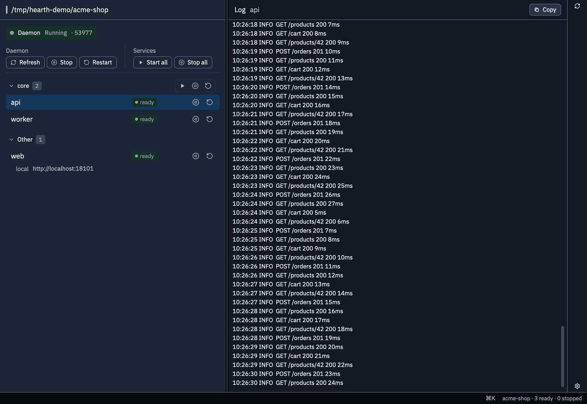
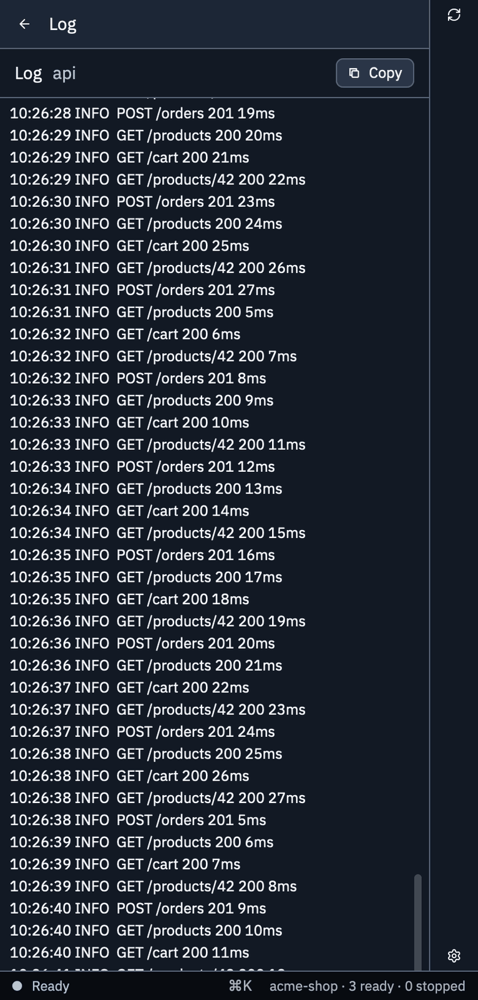

<p align="center"></p>

# hearth

Local dev services manager: one long-lived daemon per project folder, plus a CLI and MCP server.
All of them talk to the daemon over loopback HTTP+SSE. The daemon owns every managed process;
nothing else starts or stops one directly.

The product is the compiled `hearth` binary (`go/cmd/hearth`). It runs from any directory.

```
 your CLI  ─┐
 your MCP  ─┼──HTTP + SSE (loopback)──►  daemon (hearth)
 window   ─┘                                  │
                                        ProcessSupervisor (spawns/probes/tails)
```

A project supplies a `hearth.yaml` (`.yml` / `.json` also work) naming its services, how to
start them, and how to tell when they are ready. TypeScript catalogs are not accepted.

```yaml
version: 1
env: { NODE_ENV: development }
groups:
  all: [redis, api]
services:
  redis:
    kind: infrastructure
    ownership: external
    container: myapp-redis
    run: { argv: [docker, compose, up, -d, redis] }
    readiness: { kind: container }
  api:
    cwd: apps/api
    build: { argv: [go, build, ./...], timeoutMs: 120000, serializationKey: go }
    run: { shell: "air -c .air.toml", exec: true }
    readiness: { kind: tcp, port: 8080 }
    readinessTimeoutMs: 30000 # accepted; does not fail the service
    ports: [{ port: 6060, label: pprof }]
    urls:
      - http://127.0.0.1:8080
      - { url: "https://{tailnetHost}:8443", label: admin, requiresRunning: false }
```

Other top-level keys: `envFile` (a dotenv file, relative to the project root; `env:` wins on
conflict), `runtimeDirectory` (default `.hearth/runtime-v1` under the root), and
`privateFileGuard` (boolean, default on). Unknown keys fail the load, except keys that start
with `x-`. A service takes `label`, `kind` (`application` | `infrastructure`), `ownership`
(`daemon` | `external`), `disabled`, `env`, `container`, `cwd` (relative, must stay inside the
root), `run`, `stop`, `build`, `readiness`, `readinessTimeoutMs`, `preparationCommand`, `ports`,
`urls`, `artifact`, and `restart`. A command is `{ argv: [...] }` or `{ shell: "...", exec?: bool }`.
A URL may contain `{tailnetHost}`, which resolves from `$HEARTH_TAILNET_HOST` or
`tailscale status --json`.

`groups:` members may also name other groups — `all: [infra, app]` expands depth-first in
declaration order (deduplicated, cycles rejected at load). A member naming both a service and a
group resolves as the service. Clients group the service list by direct membership and offer
per-group start and stop.

`disabled: true` on a service keeps it in the catalog but out of every client lifecycle action:
direct start/stop/restart is rejected (`service_disabled`) and group targets expand past it. The
daemon's own lifecycle check stops that service's processes: the tracked tree, a port holder that
is this service, and any other host process of that service. That includes the same command, the
program a `shell` + `exec` replaced into (matched in the directory the shell `cd`s to), and a
command line that still contains that service's install directory. The check runs after the
daemon is listening, on catalog reload, and on the two-second tick. A different program on the
port is not signalled.

A command that runs and then exits — a one-shot build, not a server — uses
`readiness: { kind: exit }`. The row stays `running` until the process exits. It does not
become `ready`. Exit 0 becomes `succeeded` and is not run again until you start it; any other
exit is `failed`. `readinessTimeoutMs` does not apply: the command is not failed for still
running.

```yaml
services:
  fe:
    cwd: frontend
    run: { argv: [task, fe] }
    readiness: { kind: exit }
```

Readiness is a probe, not a deadline. After the process is up, hearth probes every 1.5s until the service is stopped or restarted, the process exits, or the daemon shuts down. A passing probe is `ready`. A failing probe is `running-unready` and leaves the process running. `hearth start --wait` returns once the process is up, whether or not the probe has passed yet. `readinessTimeoutMs` is still accepted. It does not fail a long-lived service. It bounds a single `command` probe, and a one-shot shared attach.

| Kind | Ready when | Write it |
|---|---|---|
| `http` | `GET` returns 2xx | `{ kind: http }` is `http://127.0.0.1:<port>/health`. Set `path` for any other path (`/metrics`, `/minio/health/live`). Set `url` when the host or port is not that default. `url` cannot be combined with `path` or `port`. Probed every 1.5s |
| `tcp` | the port accepts a connection | `{ kind: tcp, port: 4222 }`, or `{ kind: tcp }` when `ports:` already names the port. Probed every 1.5s |
| `command` | the command exits 0 | a real protocol check (`redis-cli ping`, `pg_isready`). Probed every 1.5s. One probe is bounded by `readinessTimeoutMs` |
| `exit` | the run command itself exits | one-shot builds. The row is `running` until exit. Exit 0 is `succeeded`. No readiness probe and no deadline. The wait polls every 1.5s |
| `container` | the named container is running | docker compose services. Probed every 1.5s |
| `process` | the process is alive | no port and no HTTP. No probe after start |
| `tailnet` | Tailscale serve is up | tailnet tasks. Probed every 1.5s |
| `log` | the run command's output matches a regex | `{ kind: log, pattern: "listening on" }`. Latches on the first match in the service log; a restart clears it |

`http` and `tcp` with no port use the first `ports:` entry. Omitting both is a load error (`needs a port`). Do not point `http` at `/health` unless that process serves the path.

`restart:` respawns a service that exits unexpectedly: `restart: { on: on-failure, maxRestarts: 5, delayMs: 2s }`.
`on` is `never`, `on-failure` (the default when `restart:` is present), or `always`. `maxRestarts`
counts consecutive unexpected exits; the count resets once the service is `ready` and on any manual
start or restart. A `stop` during the delay wins. `readinessTimeoutMs`, `build.timeoutMs`, and
`restart.delayMs` take milliseconds or a humantime string (`"30s"`, `"2m"`).

A service may declare a versioned tarball to install before its first start — same download/script
→ sha256 → extract → marker machinery the shared-services catalog uses, scoped to the project's
runtime directory instead of `~/.hearth/shared`:

```yaml
services:
  postgres:
    artifact:
      version: "16.4"
      url: "https://example.com/postgres-16.4-darwin-arm64.tar.gz"  # or script: packaging/pg-pack.sh
      sha256: "…"                                                  # required for url artifacts
    run: { argv: ["{installDir}/bin/postgres", "-D", "{dataDir}", "-p", "{port}"] }
    readiness: { kind: tcp, port: 5432 }
```

`{installDir}` (`<runtimeDir>/installs/<service>/<version>`), `{dataDir}`
(`<runtimeDir>/data/<service>`), `{port}`/`{port2}…` (declared `ports:`, else the tcp readiness
port for `{port}`), `{serviceId}` and `{projectRoot}` render into run/stop/build/preparation
commands, env values, readiness and urls at load time. The install runs once per version, before
preparation and build; an `external` or run-less service cannot declare an `artifact:`.

A `shared:` block registers machine-global singletons (postgres, redis, …) installed on the host
under `~/.hearth/shared` and run by a separate global daemon (`hearth smp`). Every repo that
registers the same `name@version` shares one instance; different versions run side by side.
Shared entries show up as ordinary `infrastructure` services — `start` attaches this project
(first start installs the service), `stop` only detaches (`manager stop` also stops an instance
no other project is attached to). `hearth shared list`, `hearth shared status`, and
`hearth shared connection` mask secrets unless `--reveal`. See `docs/shared-services.md`.

```yaml
shared:
  redis: "8.2.10"
  mongodb: "8.0.32"
  minio: "RELEASE.2025-10-15T17-29-55Z"
  kafka: "4.3.1"
  # object form: project hooks before attach + args forwarded to recipe provision + urls
  nginx:
    version: "1.30.5"
    preparationCommand: { command: { argv: ["{projectRoot}/scripts/prepare-edge.sh", "{dataDir}", "{projectRoot}"] } }
    attachArgs: ["{dataDir}/conf"]   # e.g. the shared nginx publishes this conf tree
    urls: [{ url: "https://dev.local/", label: dev }]
```

The shared `nginx` pins `127.0.0.1:18080` + `:18443`; a pf rdr anchor exposes them publicly as
`:80`/`:443` (macOS keeps <1024 privileged for everyone — the redirect is the way around it):

```bash
printf '%s\n' \
  'rdr pass on lo0 inet proto tcp from any to 127.0.0.1 port 80  -> 127.0.0.1 port 18080' \
  'rdr pass on lo0 inet proto tcp from any to 127.0.0.1 port 443 -> 127.0.0.1 port 18443' \
  | sudo pfctl -a com.apple/hearth -f - && sudo pfctl -e
```

A plain attach gets a
`/<projectId>/` location + `www/` docroot; an attach with a conf source (dir →
`conf.d/servers/<projectId>/`, file → `conf.d/servers/<projectId>.conf`) mounts whole server
blocks into the shared instance — `nginx -t` validates before reload, so a bad drop fails the
attach instead of wedging the singleton. Detach removes the project's confs via `deprovision`.

Install `hearth` onto `PATH`, then drive a project. `task install` builds the release binary
into `~/.local/share/hearth/bin/hearth-<version>`, ad-hoc signs that file, and points
`~/.local/bin/hearth` at it. `hearth update` installs the latest GitHub release into the same
layout. A daemon that is already running keeps its old binary until it is restarted.

```bash
task install          # versioned binary + symlink at ~/.local/bin/hearth
hearth update --check
hearth update
hearth --root /path/to/project status
hearth --root /path/to/project mcp
```

`hearth manager ensure --json` is the connection contract for another client: it ensures a daemon
is running for `--root` and prints `{instanceId, port, token, protocolVersion, runtimeDirectory,
root}`. `hearth manager restart --json` prints the same payload for a freshly started daemon,
replacing the old one *without* stopping its services — they are detached, and the new daemon
re-adopts them from their persisted identities. `hearth manager stop` stops the daemon and its
services: its own processes, `external` services that declare a `stop:` command (a docker compose
unit), and `shared:` entries, which detach. Off a TTY, `hearth manager stop` requires `--yes`.

## Commands

`hearth [--root <path>] <command>`; `--root` defaults to the current directory and must come first.
Commands that need a catalog read `hearth.yaml` / `.yml` / `.json` from the root. `--help`,
`--version`, `version`, `schema`, `skill`, `shared`, `workspaces`, and `update` work without one. A bare `hearth` prints help. Every command's `--help` exits 0.

| Command | What it does |
|---|---|
| `status [target] [--json]` | state of one service, a group, or all |
| `start\|stop\|restart <target> [--wait] [--json] [--dry-run] [--yes]` | lifecycle for a service or group (a group start is one bulk operation; stop and restart go member by member). `--dry-run` prints the resolved service ids and does not contact the daemon. `start --kill-unowned` asks `[y/N]` on a TTY when a port is held; off a TTY the flag requires `--yes` (exit 6) |
| `logs <service> [--tail N] [--follow] [--json]` | read a service's log (default tail 200) |
| `urls [target] [--json]` | live URLs |
| `events --follow --json` | stream daemon changes as newline-delimited JSON |
| `operation get\|watch <id> [--json]` | inspect one operation |
| `doctor [--json]` | checks the platform (macOS or Linux) and that `docker`, `tailscale`, `nc`, `ps`, `sh` resolve, then validates the catalog |
| `cleanup` | remove a stale lock no live daemon owns |
| `manager ensure\|status\|stop\|restart\|reload [--json] [--yes]` | daemon lifecycle; `ensure` can start a daemon. `reload` re-reads the catalog. `stop` needs `--yes` off a TTY |
| `daemon --root <path>` / `smp` | run the project daemon / the machine-global shared-services daemon in the foreground (clients spawn them) |
| `shared list [--json] [--mask] [--reveal]` | remote shared-service recipes. Secrets are masked unless `--reveal`. `--mask` is accepted and changes nothing. Together with `--reveal` it is a usage error |
| `shared installed\|status [--json] [--mask] [--reveal]` | installed instances and live smp status, sorted by name then version. Secrets are masked unless `--reveal`. `--mask` is accepted and changes nothing. Together with `--reveal` it is a usage error |
| `shared connection <service\|name@version> [--json] [--reveal]` | this project's connection. Secrets are masked unless `--reveal` |
| `shared install\|start\|stop <name@ver>` | manage a shared instance |
| `shared attach <name@ver> [--json] [--reveal]`, `shared probe <name@ver>`, `shared detach <name@ver> [--stop-if-unused] [--yes]` | what generated `shared:` services run. `attach` masks connection secrets unless `--reveal`. `detach --stop-if-unused` needs `--yes` off a TTY |
| `shared remove <name@ver> [--force] [--yes]` | delete an instance; `--force` is required while projects are attached. `--yes` is required off a TTY |
| `update [--check] [--json] [--force]` | install the latest GitHub release |
| `mcp` | serve the MCP tools over stdio |
| `mcp install [--name N] [--key K] [--json] <config-file>...` | write this binary's path into an MCP client config (`mcpServers.<name>` unless `--key`) |
| `skill install [--dest DIR]` | write `SKILL.md` and `scripts/*.sh` (default `~/.agents/skills/hearth`) |
| `skill check [--dest DIR] [--json]` | compare that directory with the copy embedded in this binary |
| `version [--json]` | name, version, schemaVersion, commit |
| `schema [--json] [<command>]` | command list and JSON Schemas. `mutates` marks a command that can change a process or a file. `manager ensure` and `shared ensure` are mutating |
| `workspaces list [--json]` | workspace folders the Hearth window knows (`~/Library/Application Support/HearthApp/workspaces.json`, or `HEARTH_WORKSPACE_FILE`). Read-only. A missing file is an empty list |

Exit codes: 2 usage, 3 unavailable, 4 protocol mismatch, 5 operation failed, 6 needs confirmation (`--yes`), 7 unauthorized, 8 drift or conflict. With `--json`, a failure prints `{"error":{code,exit,message,hint?}}` on stdout. `hearth update --json` keeps its report, `skill check` drift keeps the check document, `doctor --json` keeps the report when checks fail, and `shared probe` stays silent.

## MCP server

`hearth --root <project> mcp` speaks MCP over stdio. Tool names carry the prefix `local_services_`:
`status`, `logs`, `trace` (an operation by id), `events` (since a sequence number), `manage`
(start/stop/restart, optional `killUnowned`), `restart_daemon`, `stop_daemon`, `shared_list`,
`shared_status`, `shared_connection`. `manage`, `restart_daemon`, and `stop_daemon` require
`confirm: true`. The `status`, `logs`, and `manage` schemas enumerate the catalog's service ids.
`hearth skill install` ships script equivalents of the same tools, which is what coding agents are
pointed at instead of registering this server.

## Window

The workspace window is `hearth-gpui` in the sibling `ns-gpui` repo; this repo has no UI.
It is an HTTP+SSE client of the same daemon: a folder list (Workspaces), the shared-services view
(Shared), services grouped by `groups:`, per-service and per-group start, stop and restart, and a
log pane with a pinned `daemon log` row. Stop, restart, forget, and kill-and-start ask for
confirmation. `task dev:install` builds the Dev app from `../ns-gpui` into
`~/Applications/Hearth Dev.app`; `task dev:install:all` installs the CLI first.

## Screenshots



The window at 1440x900 with a throwaway demo project (`/tmp/hearth-demo/acme-shop`) as its only workspace: the sidebar's Workspaces tab (Shared is the other tab), the Daemon row with its round status badge (hover it for the state and daemon note), three started services grouped by `groups:`, and the `api` log open.



The same demo project at 390 px: the log pane takes the full width.

## Build and test

```bash
cd go
go test ./...
go vet ./...
gofmt -l .    # must print nothing
```

`task test`, `task clippy` (vet + gofmt), and `task ci` do the same from the repo root.
`task go:build` leaves a plain `go/hearth`. Shared-service tarballs: `task catalog:package`,
`task catalog:write`, `task catalog:smoke`.

The suite needs a running `docker` daemon, `tailscale`, plus `nc`, `ps`, and `sh`.

See [ARCHITECTURE.md](ARCHITECTURE.md) for how the daemon, the CLI, and the window sit on each other, and [AGENTS.md](AGENTS.md) for sharp edges and how `task install` refreshes the binary.
Shared services are specified in [docs/shared-services.md](docs/shared-services.md).

## Release

The version string is the repo-root `VERSION` file (stamped into the binary with
`-ldflags "-X main.version=..."`). Pushing a `v*.*.*` tag runs CI
(`.github/workflows/ci.yml`). A successful tag run starts `.github/workflows/release.yml`, which
runs `go build ./cmd/hearth`, ad-hoc signs the binary, and uploads `hearth-<tag>` to the
GitHub Release. A red CI run does not publish. `hearth update` installs that asset.
