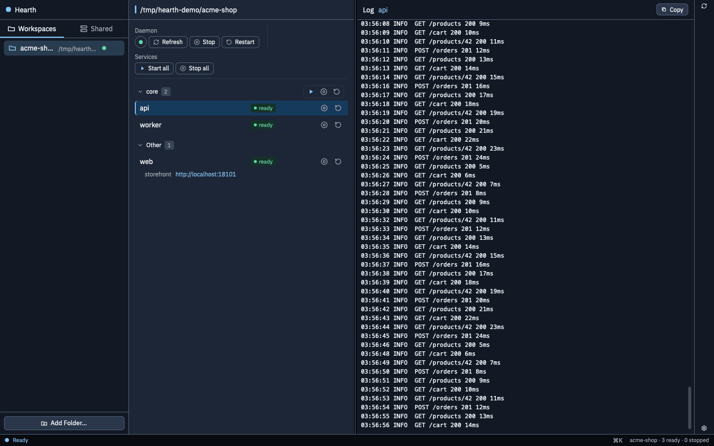

# hearth-gpui

Hearth uses the saved workspace file (`HEARTH_WORKSPACE_FILE` overrides the path). Its sidebar has two tabs, Workspaces and Shared. It can add, trust, forget, and refresh a folder, and it reads `status`, `urls`, `logs`, `manager status`, and `shared list` / `shared installed`. Start, stop, restart, group actions, reclaim, and daemon or shared lifecycle commands go to the hearth CLI, after the same confirmations as the Swift app. Refresh never runs `manager ensure`.

The window links the shared chrome crate `ns-ui` from the `ns-gpui` repo and calls the installed `hearth` CLI. Build and install the Dev app with `../ns-gpui/scripts/install-dev.sh hearth`; run it from cargo with `cargo run --release` in this directory. Dev control (`ns-dev hearth …`) is described in `ns-gpui/docs/dev-channel.md`.

Hearth: the left sidebar switches between Workspaces and Shared. The Daemon row starts with a round status badge (green running, red stopped, amber while a command runs); hovering it shows the state and the daemon note. Services are grouped by each service's `group:` field with per-group and per-service actions, and the selected service's log fills the right pane. More in the [hearth README](https://github.com/ngosangns/hearth#readme).
